# legos-factory — UX specification

Status: runnable interaction prototype, 24 October 2026. These notes specify the current artifact and identify illustrative boundaries.

## Visual and interaction direction

Contemporary SaaS with quiet porcelain surfaces, indigo ink, violet focus/action states, and apricot/mint accents. The memorable element is a five-agent assembly line with original brick-inspired characters, not trademark artwork. Foreman wears an amber hardhat; Architect a violet beret; Builder a blue cap; Inspector mint attire/glasses; Cataloger rose attire with a book. Local system sans typography carries UI; a serif greeting gives Overview a more human entry.

The animated conveyor communicates work moving through perspectives. Task bricks, dependency edges, a progress ring, modal entrances, hover/focus states and state feedback show changes. `prefers-reduced-motion: reduce` removes animations/transitions. Status never relies on color or animation alone.

## Information architecture

| Destination | Purpose | Main interactions |
|---|---|---|
| Overview | Greeting and monitoring | Open decisions/project work, inspect persona, usage/resources |
| Factory | All work across projects | Search/filter, board/list, project profile, new work, order drill-down |
| Order / Blueprint | Intent, contract, planning and clarification | Draft, review, answer, revise, approve, export |
| Order / Task graph | Dependencies and execution stage | Inspect node, advance, pause/resume, optional Auto-play |
| Order / Activity | Source of workflow history | Read role-attributed events and simulated sandbox log |
| Order / Quality | Evidence and findings | Inspect contract/artifacts, fix and recheck, continue to decision |
| Order / Changes & PR | Sample diff and human disposition | Approve, request changes, decline, export summary |
| Cataloger | Optional future concept | Enable sample preview, search records, inspect provenance/source |
| Settings / Governance | Admin workspace boundary | Defaults, allowlist, maximum autonomy |
| Settings / My preferences | Allowed personal choices | Governance preferences, theme, reset |
| Settings / Team & access | Membership and user caps | Add sample member, change role, edit per-user budget |
| Settings / Integrations | Connection scope/ownership | Shared/personal demo enable/disable and consent preview |
| Settings / Usage & resources | Limits and monitoring | Budget, concurrency, vCPU/memory, illustrative usage |

Search is available from the top bar and Cmd/Ctrl+K. Notifications open current work orders needing a human. The workspace control links to team management.

## Order state model

```mermaid
stateDiagram-v2
    [*] --> Draft: Create work order
    Draft --> ArchitectReview: Draft blueprint
    ArchitectReview --> Clarification: Missing contract
    Clarification --> PlanReady: Record decision and re-review
    ArchitectReview --> PlanReady: Review passes
    PlanReady --> ArchitectReview: Request plan revision
    PlanReady --> Building: Human approves / delegated policy authorizes
    PlanReady --> Queued: No run slot
    Queued --> Building: Retry with free slot
    Building --> Paused: Human pauses / policy or budget gate
    Paused --> Building: Resume after gates pass
    Building --> QAFinding: Simulated regression found
    QAFinding --> PRDecision: Fix and recheck on new revision
    PRDecision --> Paused: Request changes; invalidate review
    PRDecision --> Complete: Record human demo approval
    PRDecision --> Closed: Record decline and reason
```

The actual simulation uses explicit user actions. Assisted/delegated Auto-play is optional and stops when leaving the order. Queue scheduling is retried explicitly. No backend or background worker exists.

## New work-order drawer

1. **Intent:** title, project/repository, desired outcome, observable acceptance criteria. Required values reject whitespace-only input. The repository reflects the selected project.
2. **Crew:** permitted Builder/Inspector models, resolved governance defaults/preferences, autonomy no higher than workspace policy.
3. **Review:** scope, criteria, selected models, autonomy, resources and an illustrative estimate. Creating saves a draft and opens Blueprint.

Back retains entered values. Nothing calls a provider. Governance model snapshots are fixed when the order is created; task Builder/Inspector assignments remain editable before execution. During paused work, autonomy can be lowered to meet policy; execution model assignments remain fixed.

## Human decisions and quality

Architect’s clarification records an explicit contract. The seeded payment order asks about idempotency lifetime; other sample projects use a compatibility question. This is a scripted example, not actual requirement analysis. Blueprint approval leads to the graph. Draft requirements, source decisions and verification gates remain inspectable.

The graph is baseline → two independent branches (implementation and contract tests) → inspection. Node dialogs expose dependencies and evidence expectations. Inspector deliberately produces one sample regression failure on execution completion. A targeted simulated fix increments the revision and produces new review evidence. Human request-changes also increments the revision and invalidates previous quality approval.

The evidence drawer and sample diff explicitly state that results and code are illustrative. The final approval/decline records a local decision, without publishing or merging anything. Exports create a work-order-specific Markdown blueprint or review summary.

## Policy and limits

| Control | Visible consequence |
|---|---|
| Admin → Member | Workspace policy and shared-connection editing become disabled |
| Viewer role | Work mutations stop; inspection remains available |
| Remove an allowed model | New selections exclude it; affected active runs pause |
| Disable a provider connection | New/resumed work using it is blocked; affected active work pauses |
| Lower budget below usage | Active work pauses and resume is blocked |
| Lower concurrency | Excess active runs pause; a new start can queue |
| Lower autonomy ceiling | Affected active work pauses; order autonomy may be lowered |
| Change preferences | Applies to future order governance snapshots |

The user budget gates simulated fixed-cost execution steps; it is not token accounting. Other sample members’ caps are editable records, not separate logged-in run sessions. Resource choices configure the demo’s displayed sandbox specification; no resources are allocated.

## Responsive behavior

- Wide desktop: persistent labeled navigation, four-column Factory board, main order content plus configuration sidebar.
- Tablet: compact icon rail; two-column board; order configuration moves below main content.
- Mobile: menu button with scrim, stacked settings/forms, two-column compact board, horizontally scrollable context tabs and graph. The graph may scroll internally; the page should not overflow horizontally.
- New-order drawer becomes edge-to-edge on mobile. Buttons and inputs remain keyboard-accessible and labeled.

## Accessibility

Semantic landmarks/headings, visible focus rings, skip-to-content, accessible icon-button names, text status labels, native form labels/validation, live toast region, modal title and modal semantics, background inertness, keyboard focus trapping, Escape to close and focus restoration. No control needs a hover-only gesture. Reduced motion is handled in CSS; no media-emulation audit is claimed.

This is not a completed WCAG conformance audit. Browser walkthroughs and responsive inspection are recorded separately in `VERIFICATION.md`.

## Deliberately open product questions

Real repository onboarding and command discovery; worker interruption/retry; per-repository/team permissions; specialist Inspector composition; authoritative pricing and in-flight budget reservation; provider/subscription authentication; real PR creation vs approval vs merge authority; retention/redaction of evidence; Cataloger curation, correction and freshness. The prototype should support discussion of these choices without presenting them as implemented.
